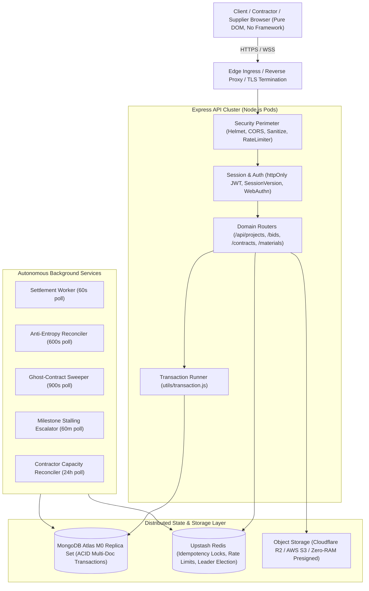
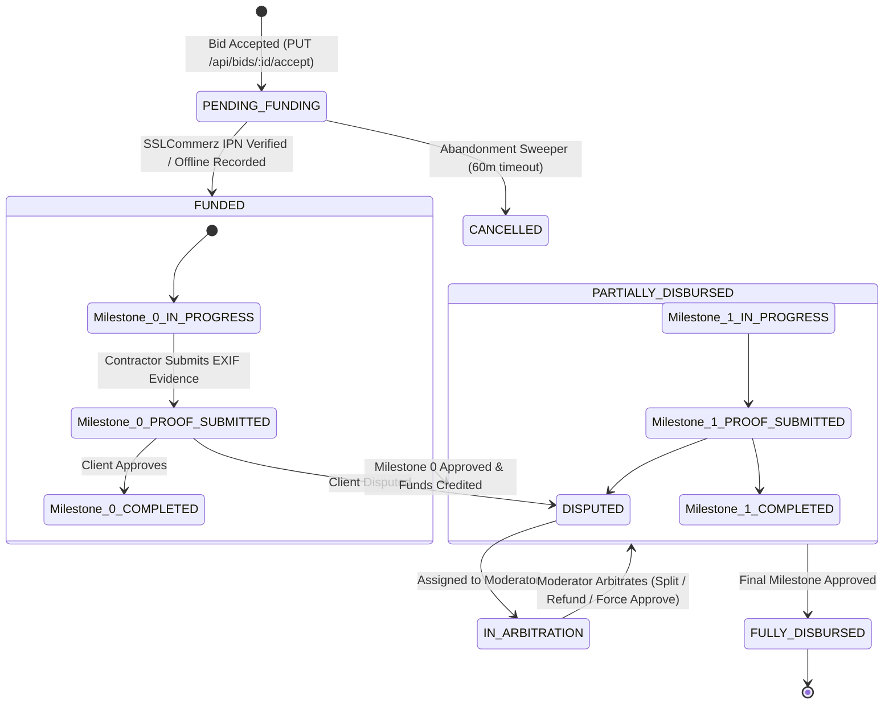
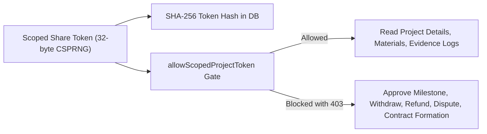

# Build-BD System Architecture & Technical Specifications

> Comprehensive reference guide for the engineering architecture, data pipelines, security perimeter, and financial state machines of Build-BD Marketplace.

---

## 1. High-Level System Architecture

---

## 2. Express Middleware Pipeline Execution Order

Every incoming HTTP request passes through a strictly ordered pipeline in [`server.js`](file:///D:/build-bd-marketplace/server.js):

1. **`helmet()`**: Applies HTTP security headers (strict CSP, HSTS, `frame-ancestors 'none'`, no inline scripts).
2. **`cors()`**: Restricts origins strictly to configured `CORS_ORIGIN` (rejects wildcards in production).
3. **`express.json({ limit: '10kb' })`**: Parses request payload safely, preventing large-body memory exhaustion.
4. **`hpp()`**: HTTP Parameter Pollution guard.
5. **Static File Serving**: Serves `/app/*` and pre-rendered assets.
6. **`middleware/sanitize.js`**: Deep recursive sanitizer stripping `$` and `.` operators to defeat NoSQL injection attacks.
7. **`apiLimiter`**: Distributed Redis-backed rate limiter (120 req/min per user / IPv6 `/56` subnet).
8. **Route-Specific Limiters**: `strictAuthAndBidLimiter` (30/15min) and `financialLimiter` (10/10min).
9. **`verifyToken` ([`middleware/auth.js`](file:///D:/build-bd-marketplace/middleware/auth.js))**: Resolves session from httpOnly cookie or Bearer header; verifies CSRF `X-Requested-With` on state-changing requests; checks instant revocation via `sessionVersion`.
10. **Role Gate (`requireRole`)**: Enforces clearance (`CLIENT`, `CONTRACTOR`, `SUPPLIER`, `ADMIN`, `MODERATOR`).
11. **Idempotency Gate (`enforceIdempotency`)**: Uses Redis distributed locks with MongoDB fallback to ensure at-most-once execution of financial mutations.
12. **Domain Route Handler**: Executes business logic within an ACID MongoDB session.
13. **Central Error Handler**: Formats operational vs. internal errors with zero sensitive stack disclosure.

---

## 3. Escrow Financial State Machine

### Money Representation & Invariants
- All currency values are stored as **integer BDT** (Bangladeshi Taka). No floating-point or fractional numbers are permitted in any ledger model.
- Platform fee (default 5%) is deducted from contractor payout:
  $$\text{Contractor Net} = \text{Milestone Gross} - \lfloor \text{Milestone Gross} \times 0.05 \rfloor$$
- Upon milestone approval, funds enter contractor `wallet.pendingClearance` and mature after a 2-calendar-day settlement window, upon which the autonomous Settlement Worker shifts them to `availableToWithdraw`.

---

## 4. Probashi Hub & Delegation Boundary

- Raw 32-byte tokens are never stored in the database; only their SHA-256 digests (`tokenHash`) are persisted.
- Scoped roles (`FAMILY_VIEWER`, `SITE_WATCHER`) are strictly isolated from any financial mutation by both centralized URL classification (`isFinancialPath`) and negative tests against all `MONEY_ROUTES`.
- If `hideFinancials: true` is configured on the delegation token, the DTO layer scrubs budgets, total contract values, and material line totals to `null` before sending to the client.

---

## 5. Background Workers & Distributed Leases

To eliminate redundant executions when running in multi-replica environments (`replicas: 3`), all four background workers use the distributed leader election module ([`services/workerLock.js`](file:///D:/build-bd-marketplace/services/workerLock.js)):

| Worker | Interval | Lease TTL | Responsibility |
|---|---|---|---|
| **Settlement Worker** | 60s | 58s | Checks mature milestones past clearance date, atomically credits `availableToWithdraw`. |
| **Reconciliation Worker** | 600s | 595s | Verifies payment receipts against SSLCommerz gateway records, detecting orphan payments. |
| **Ghost Abandonment Sweeper** | 900s | 895s | Cancels un-funded contracts older than 60 minutes, returns projects to bidding pool, restores contractor bidding capacity. |
| **Milestone Stalling Escalator** | 60m | 3590s | Flags milestones pending client review for ≥7 days without action, unlocking contractor dispute rights (anti-withholding guard). |
| **Capacity Reconciler** | 24h | 86395s | Recalculates live project counts across contractor profiles to prevent counter drift. |

*All workers fail open: if Redis is disconnected or degraded, the workers run independently rather than halting platform settlement.*

---

## 6. Anti-Fraud & Market Integrity Safeguards

- **Dual-Sensor Geofencing & EXIF Verification:** Evidence photos require valid site coordinates matching project bounds via the Haversine great-circle formula. Dynamic Accuracy Thresholding adapts to local phone GPS drift ($40\text{m}$ base up to $80\text{m}$ hard cap). When device GPS is supplied alongside EXIF data, a cross-sensor agreement check ($<500\text{m}$) guards against synthetic metadata injection.
- **Contractor Sybil Defense:** National ID numbers are salted and stored strictly as one-way SHA-256 hashes (`nidHash`) to prevent storing plaintext PII while allowing duplicate detection. Trade licenses are indexed and duplicate licenses across profiles are surfaced automatically in the administrator's review queue.
- **Material Variance Detection:** Real-time checking on brand substitutions and quantity variances against the project's planned specifications, broadcasting alerts proactively over WebSockets to client owners upon delivery logging.

