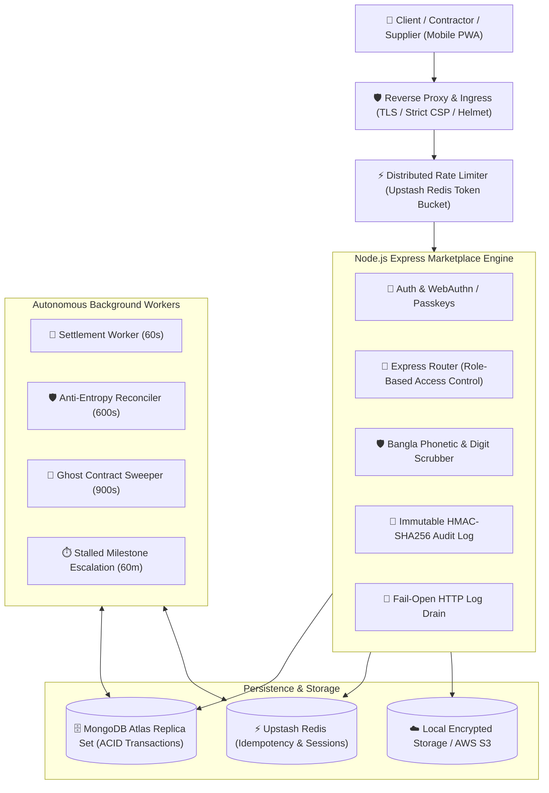

# Build-BD — Construction & Materials Marketplace

[](https://nodejs.org)
[](https://www.mongodb.com)
[](https://redis.io)
[](npm%20test)
[](npm%20run%20qa:ci)
[](#-intellectual-property--license)

> **Bangladesh's First Mission-Critical, Escrow-Protected Construction & Materials Marketplace**  
> Engineered by **M. Iftida Mushfiq Arnab** (Lead Software Engineer & Architect)

Build-BD connects property owners (clients), verified contractors (ঠিকাদার), and building materials suppliers with **cryptographic milestone escrow, live GPS camera site verification, mill-rate material ordering, and resilient autonomous governance.**

---

## 🌐 Live Interactive Demo

- **Public HTTPS Portal:** [**https://endearing-suffrage-body.ngrok-free.dev**](https://endearing-suffrage-body.ngrok-free.dev)
- **Direct Web App:** [**https://endearing-suffrage-body.ngrok-free.dev/app/**](https://endearing-suffrage-body.ngrok-free.dev/app/)
- **Live System Health Check:** [`GET /health/readiness`](https://endearing-suffrage-body.ngrok-free.dev/health/readiness)

---

## 👨‍💻 What I Built & Key Technical Achievements

As the sole architect and lead engineer of this platform, I designed, implemented, and verified the complete stack end-to-end:

### 1. High-Stakes Financial State Machines & ACID Escrow
- **Zero-Drift Milestone Escrow:** Multi-document ACID transactions across MongoDB replica sets ensuring 100% balance conservation between client deposits, contractor tranches, and platform treasury.
- **Strict CAS Idempotency:** Distributed Redis token-bucket rate limiting backed by MongoDB fallback persistence (`IdempotencyKey`) preventing double-spend attacks and parallel race conditions.
- **Automated Payout State Machine:** Multi-phase settlement reconciler handling MFS/Bank payouts with compensating refunds for ambiguous network timeouts.

### 2. Cryptographic Anti-Fraud & Deep Localization
- **Tamper-Evident GPS EXIF Site Verification:** Server-side extraction and cryptographic validation of live rear-camera EXIF metadata (forcing `facingMode: environment`), matching physical site coordinates against pre-registered project boundaries, paired with SHA-256 duplicate image hashing.
- **Bangla Numeral & Phonetic Contact Scrubber:** Custom regex and token normalization engine detecting and redacting Bengali digits (`০-৯`), Banglish phonetic spellings (*"shunno ek saat"*), and Bengali words (*"শূণ্য এক সাত"*) to eliminate platform bypass and off-platform disintermediation.
- **WebAuthn Biometric Passkeys:** Frictionless Touch ID / Face ID / Android Fingerprint authentication alongside an operator-relayed OTP fallback.

### 3. High-Performance Autonomous Background Workers
- **Settlement Worker:** 60-second polling cycle executing cleared milestone tranches.
- **Anti-Entropy Ledger Reconciler:** 600-second audit scanning every ledger for state invariants and financial balance anomalies.
- **Ghost-Contract Abandonment Sweeper:** 900-second cleanup cycle automatically expiring unacted draft tenders.
- **Milestone Stalling Escalation Engine:** Proactive anomaly detection for halted contractor workflows, dispatching WebSocket toasts and SMS alerts.

### 4. Zero-Framework-Bloat Frontend Architecture
- **Pure DOM Architecture:** Complete elimination of bulky JavaScript frontend frameworks (no React/Vue hydration overhead, 0 `innerHTML` XSS sinks, 100% strict Content Security Policy).
- **Mobile-First Responsive PWA:** Dynamic viewport height (`100dvh`), iOS safe-area handling (`viewport-fit=cover`), offline form persistence (`formPersist.js`), and bilingual parity (English + Bengali) loading in under 1.5 seconds on 3G/4G networks.

---

## 🏗️ System Architecture



---

## 🧪 Rigorous Quality Assurance & Test Pyramid

The repository enforces a military-grade automated test battery with **zero tolerance for failures**:

```text
▶ Frontend Compilation:   PASS (19 pages, 36 JS modules, zero asset drift)
▶ Static QA CI Gates:     PASS (120/120 gates passed, 0 fail, 0 warn)
   - Static Gates:         17 passed (Zero innerHTML, strict CSP)
   - Declared Deps:        3 passed (Zero undeclared packages)
   - Route Policy:         28 passed (104 endpoints verified for idempotency & auth)
   - Schema Policy:        35 passed (Integer BDT enforcement, unique indexes)
   - Query Plans:          37 passed (Index utilization verification)
▶ Full Test Battery:      PASS (58/58 test suites passed, 100% green)
▶ Ledger Invariant Scans: PASS (10/10 invariant balance checks passed)
```

### Running the Test Battery
```bash
# Execute all 58 test suites (fuzz testing, concurrency races, financial invariants)
npm test

# Run all 120 static architecture policy gates
npm run qa:ci

# Run ledger invariant state scan
npm run qa:ledgers
```

---

## 📁 Repository Structure

```text
build-bd-marketplace/
├── frontend/             # Clean HTML templates, vanilla JS modules, Tailwind styles
│   ├── js/pages/         # Page controllers (login, dashboard, post-project, withdraw, etc.)
│   ├── partials/         # Reusable responsive components (header, footer, head)
│   └── styles/           # Tailwind base styles and self-hosted fonts (Inter, Noto Sans Bengali)
├── middleware/           # Rate limiters, RBAC auth, sanitize scrubber, idempotency guards
├── models/               # Mongoose schemas (18 models with strictly synced unique/TTL indexes)
├── routes/               # Modular Express 5-safe API endpoints (payment, finance, bid, chat, etc.)
├── scripts/              # Frontend compiler, QA runner, database index synchronization
├── services/             # Bank payouts, evidence hashing, OTP delivery, Redis client
├── tests/                # 58 comprehensive test suites (E2E, unit, fuzz, concurrency races)
├── utils/                # Winston structured logger with remote HTTP drain transport
└── server.js             # Application entrypoint, socket.io negotiation, daemon workers
```

---

## 🔒 Intellectual Property & License

**Copyright © 2026 M. Iftida Mushfiq Arnab. All rights reserved.**

### Proprietary Software Notice
This repository is made public **strictly for portfolio showcase, architectural demonstration, and recruitment evaluation purposes**. 

- **Recruiters & Hiring Teams:** You are warmly invited to inspect, review, and evaluate the source code, system architecture, test suites, and documentation.
- **Restrictions:** Unauthorized reproduction, commercial redistribution, copying of proprietary code, deploying competing services, or public mirroring without the explicit written permission of the author is **strictly prohibited** under international copyright treaties (Berne Convention) and digital intellectual property laws.

---

## 📬 Contact & Portfolio

**M. Iftida Mushfiq Arnab**  
- **Email:** [miftida@gmail.com](mailto:miftida@gmail.com)  
- **GitHub:** [@mushfiqarnab](https://github.com/mushfiqarnab)  
- **Role:** Lead Full-Stack Architect & Distributed Systems Engineer
