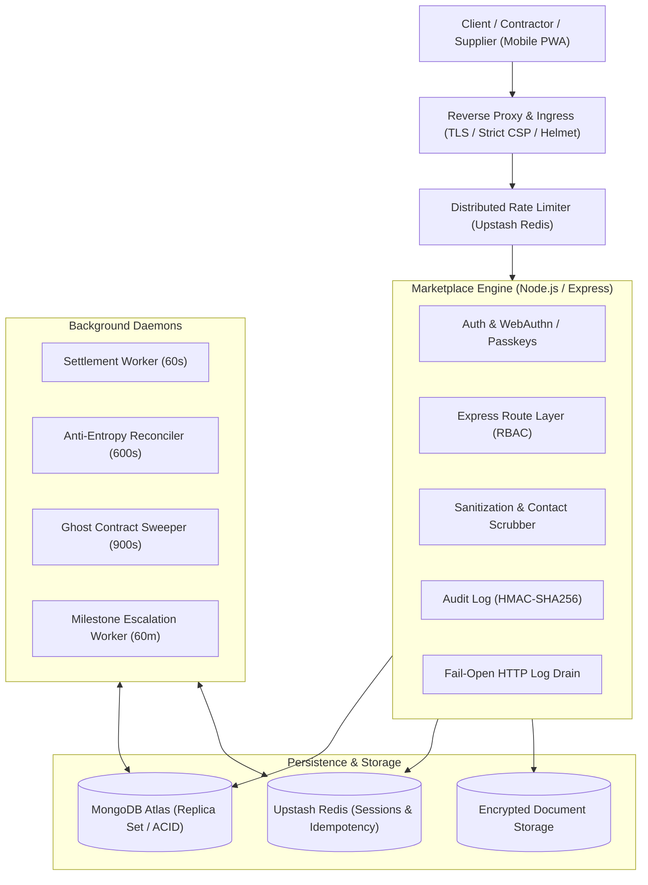

# Build-BD Marketplace

A milestone-escrow construction and building materials marketplace designed for the private construction sector in Bangladesh.

Build-BD connects property owners, verified contractors, and building materials suppliers through cryptographic milestone escrow, tamper-evident GPS evidence logging, and automated settlement governance.

---

## Technical Architecture & Core Systems

### 1. Financial Ledger & ACID Escrow State Machine
- **Transaction Consistency:** Milestone disbursements, escrow allocations, and platform fee splits execute within MongoDB multi-document ACID transactions with integer BDT precision.
- **Idempotency & Concurrency:** Financial routes use Compare-and-Swap (CAS) state validation with Upstash Redis token-bucket rate limiting and MongoDB `IdempotencyKey` fallback to prevent parallel execution or double-spending.
- **Automated Settlement & Reconciliation:** Background workers poll on scheduled intervals to execute approved milestone disbursements, reconcile ledger state invariants, and clean up abandoned drafts.

### 2. Fraud Prevention & Geofencing
- **Site Evidence Verification:** Milestone completion uploads validate EXIF metadata from the camera stream, confirming GPS coordinates against site boundaries and verifying image SHA-256 hashes against duplicate submissions.
- **Contact Leak Scrubber:** Inbound freeform text fields pass through a multi-pass sanitizer that detects and redacts Bangladesh mobile numbers across ASCII digits, Bengali numerals (`০-৯`), and phonetic Banglish transcriptions.
- **Authentication:** WebAuthn Passkeys (Touch ID, Face ID, Android Biometrics) supported as primary authentication with an operator-relayed OTP fallback channel.

### 3. Frontend Architecture
- **Pure DOM Architecture:** Built without frontend framework overhead (no React/Vue hydration cost, zero `innerHTML` usage, compliant with strict Content Security Policy).
- **Responsive Mobile PWA:** Styled with Tailwind CSS, supporting mobile viewports (`100dvh`), iOS safe areas (`viewport-fit=cover`), and client-side draft auto-recovery (`formPersist.js`).
- **Bilingual Interface:** Complete language parity across English and Bengali (`Noto Sans Bengali`), with localized date and Lakh-grouping currency formatters (`৳X,XX,XXX`).

### 4. Nirman-AI & Domestic Labour Trust Architecture
- **Nirman-AI Conversational Concierge:** Bilingual Web Speech API and text intent orchestrator resolving colloquial Bangla, Banglish, and English inputs into geolocated service plans, pricing models, and direct action pathways (`POST /api/ai/orchestrate`).
- **Three-Ring Trust Architecture:**
  - *Ring 1 (Government Biometrics):* Porichoy National ID biometric verification requiring `face_match_percentage >= 80%` and 18+ adult age validation.
  - *Ring 2 (Digital Darwan Graph):* Verification through at least two active vouched community anchors (Darwan/Caretaker and Rural Kin).
  - *Ring 3 (DMP CIMS Police Dossier):* Instant automated generation of Dhaka Metropolitan Police Citizen Information Management System dossiers and QR Smart ID cards.
- **DWPWP-2015 Compliance & 80/15/5 Weekly Payroll:** Domestic worker contracts enforce maximum 12-hour days, mandatory 4 paid weekly holidays per month, double-blind IVR rating, a 48-hour Police GD security dispute gate, and weekly Thursday automated payroll (80% immediate disbursement, 15% continuity reserve, 5% platform fee).
- **Dual-Speed Tier 1 Micro Dispatch:** Instant 5km `$geoNear` geospatial dispatch for emergency utility repairs with ৳0 booking advance, ৳200 visiting floor guarantee, 4-digit completion OTP, and 7-day warranty retainage (`POST /api/v2/projects/micro/dispatch`).

---

## System Overview



---

## Test Battery & Quality Gates

The repository contains an automated verification suite covering unit, integration, fuzzing, and architectural policy assertions.

```text
Microscopic Preflight:     11/11 cross-layer gates passed (0 defects across 246 files)
Static Policy Gates:       120+ passed (static, deps, route policies, schemas, query plans)
Automated Test Suites:     60 passed (ACID retries, idempotency races, state-machine fuzzing)
Ledger Invariants:         10 passed (conservation of funds, balance assertions)
Asset Verification:        Zero drift between source and public/app distribution
```

### Running Tests Locally

```bash
# Run microscopic cross-layer preflight verifier
node scripts/qa/cli-microscopic-preflight.js

# Run full automated test suite (60 suites)
npm test

# Run static QA architecture policy checks (120 gates)
npm run qa:ci

# Run ledger invariant audit
npm run qa:ledgers

# Build frontend distribution bundle
npm run build:frontend
```

---

## Repository Structure

```text
build-bd-marketplace/
├── frontend/             # HTML templates, JavaScript modules, Tailwind styles
│   ├── js/pages/         # Page controllers (login, dashboard, contract, post-project, etc.)
│   ├── partials/         # Reusable layouts (header, footer, head)
│   └── styles/           # Tailwind base styles and self-hosted fonts
├── middleware/           # Rate limiting, auth guards, input sanitizer, idempotency checks
├── models/               # Mongoose schemas (18 models with synchronized unique/TTL indexes)
├── routes/               # Modular Express API endpoints (payment, finance, bid, chat, etc.)
├── scripts/              # Build pipelines, QA runners, index sync utilities
├── services/             # Bank payouts, evidence hashing, OTP delivery, Redis client
├── tests/                # 58 test suites (E2E, unit, fuzzing, concurrency races)
├── utils/                # Winston structured logger with HTTP drain transport
└── server.js             # HTTP server entrypoint, socket.io gateway, background workers
```

---

## License & Intellectual Property

Copyright (c) 2026 M. Iftida Mushfiq Arnab. All rights reserved.

Proprietary software. This repository is made public for portfolio evaluation and technical review. Unauthorized copying, modification, commercial deployment, or redistribution of this software is strictly prohibited.
